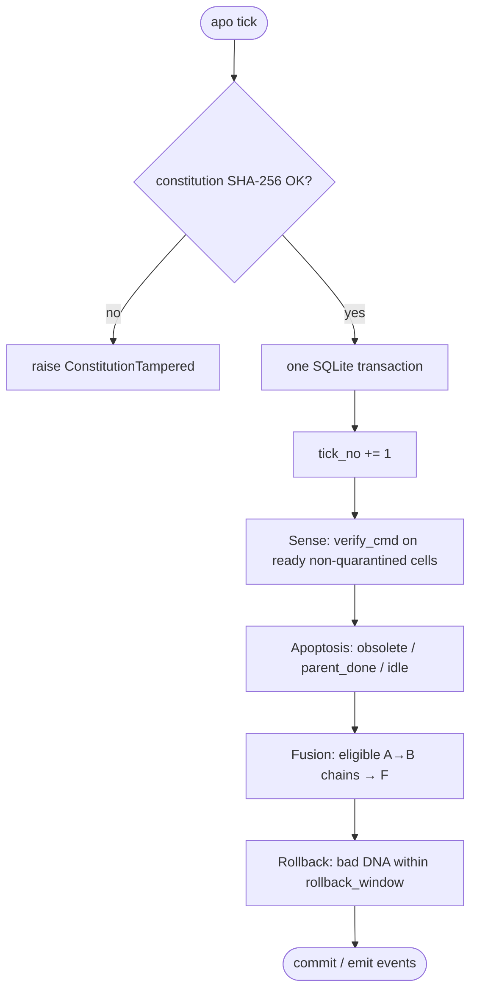

# Concepts for developers

This page explains the objects and laws in [SPEC.md](SPEC.md) for people
implementing or calling the Python API and `apo` CLI. Field names match
`src/autopoiesis/model.py`.

## Cell anatomy

A **cell** is one task node in the SQLite graph (`.apo/cells.db`).

| Part | Fields | Mutable? |
|---|---|---|
| Membrane (contract) | `verify_cmd`, `deps` | `verify_cmd` never after birth |
| DNA | `instruction`, optional `run_cmd` | yes, only via versioned mutation |
| Metabolism | global `energy`; per-cell `pressure` | kernel only |
| Epigenetics | `versions`, `runs` tables | append-only |

**States** (`STATES` in `model.py`): `active`, `done`, `dead`, `fused`,
`quarantined`.

- **Ready:** `active` and every dependency is `done`.
- **Pressure:** `pressure(c) = 1 +` number of active cells that transitively
  depend on `c` ([SPEC.md](SPEC.md) §1).
- **Ids:** `c-` plus 6 hex characters.

`obsolete_cmd` is an apoptosis sensor: exit 0 means the cell is no longer
needed.

## The three laws

Enforced in code, never by an LLM ([SPEC.md](SPEC.md) §2).

1. **Soma vs. germline.** `constitution.toml` holds goal, budget, limits,
   trust, and fitness checks. The kernel never writes it. `init` stores its
   SHA-256; every `tick` / `run` / `fitness` raises `ConstitutionTampered`
   if the hash differs until a human runs `apo ratify` (hash detection, not
   filesystem read-only protection). Kernel source is germline too: cells
   mutate; the kernel does not. A parent becomes `done` only when **its
   own** `verify_cmd` passes — children cannot fake parent success.
2. **Metabolic cost.** One global energy pool (`budget.initial_energy`).
   Mutation costs `mutation_cost`, mitosis `mitosis_cost`. Energy is earned
   only by verified progress (`reward_per_done`, `reward_per_fitness`). Hard
   caps: `limits.max_cells` (counts `active` **and** `quarantined` cells),
   `max_depth`, `max_children`. Insufficient energy → process skipped, event
   `energy_denied`.
3. **Transactions + rollback reflex.** `run()` is one SQLite transaction.
   `tick()` runs sense, apoptosis, fusion, and rollback in **one**
   transaction (not one per process). Every DNA change appends a `versions`
   row (`origin` = `birth` | `mutation` | `rollback`). After
   `rollback_window` runs, a worse failure rate restores previous DNA and
   taboos the bad hash. Oscillation guard: reject DNA hashes already used
   by that cell, or mutations sooner than `mutation_cooldown_ticks`.

## The four processes

### On `run(cell)` ([SPEC.md](SPEC.md) §3)

1. Execute optional `run_cmd`, then `verify_cmd` (timeout
   `trust.command_timeout_s`).
2. Record a `runs` row. `ok` = both exit 0.
3. On success → `done` (+reward if newly done), clear `fail_streak`.
4. On failure → increment `fail_streak`, then:
   - **Mitosis** if streak ≥ `fail_streak_for_mitosis` and depth / caps /
     energy allow: mutator `split()` → children (`depth+1`, parent gains deps
     on children). Children start `quarantined` unless
     `trust.auto_approve_llm_commands`. If `split()` returns no children, the
     mitosis attempt still counts as handled: energy is refunded and
     **no recombination** runs on that failure.
   - **Recombination** only when mitosis was not attempted, or when mitosis
     was refused (depth / caps / energy): mutator `critique()` → `Gradient`
     applied as a DNA mutation (new `run_cmd` quarantines unless
     auto-approve).

### On `tick()` — the heartbeat

Deterministic; no LLM. Constitution hash is checked first, then
sense → apoptosis → fusion → rollback run inside **one** SQLite transaction
([SPEC.md](SPEC.md) §3; `Kernel.tick` in `kernel.py`):

1. Constitution hash check; `tick_no += 1`
2. **Sense:** every ready, non-quarantined cell runs `verify_cmd`
3. **Apoptosis:** `obsolete_cmd` → dead; active descendants of a `done`
   parent → dead (`parent_done`); idle past `idle_ttl_days` → dead
4. **Fusion:** eligible linear A→B chains become F with concatenated commands
5. **Rollback** check (Law 3)

`fitness()` also checks the constitution hash (refuses a changed file with
`ConstitutionTampered`), then runs each `[[fitness]]` check and rewards
fail→pass flips.

## Heartbeat diagram

## Mutator contract

`Mutator` protocol in `model.py`:

- `split(cell, failure_log, max_children) -> list[ChildSpec]`
- `critique(cell, failure_log, upstream) -> Gradient | None`

`NullMutator` never rewrites DNA; the graph still senses, dies, fuses, and
rolls back. `OpenAIMutator` / `from_env()` are the LLM backends named in
SPEC §6.

## CLI surface

Only the commands in [SPEC.md](SPEC.md) §7: `init`, `add`, `status`, `next`,
`show`, `run`, `tick`, `watch`, `approve`, `ratify`, `fitness`, `graph`,
`log`, `hook install`. See [examples/python-project/README.md](../examples/python-project/README.md).
